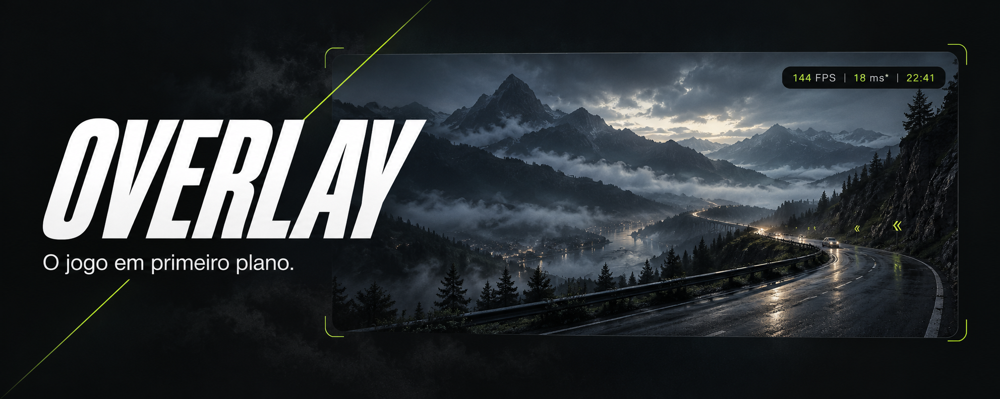
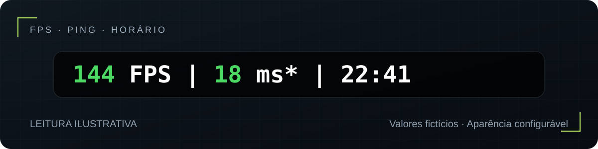

<p align="center">
  
</p>

<h1 align="center">Seu jogo. Três informações. Um canto da tela.</h1>

<p align="center">
  <strong>FPS, ping e horário em uma faixa discreta para Windows.</strong><br>
  Confira a leitura, mantenha o foco e continue jogando.
</p>

<p align="center">
  
  
  
</p>

<p align="center">
  <a href="#começar">Começar</a> ·
  <a href="#uma-olhada-basta">Ver a leitura</a> ·
  <a href="#do-seu-jeito">Personalizar</a> ·
  <a href="#perguntas-que-importam">Perguntas frequentes</a> ·
  <a href="https://github.com/Daniellpego/overlay/issues">Reportar um problema</a>
</p>

<p align="center"><sub>Capa original gerada por IA. Cenário e métricas ilustrativos; não é captura de jogo.</sub></p>

---

## O jogo ocupa a tela. O Overlay encontra um canto.

Você quer acompanhar a fluidez, conferir a resposta da conexão e saber que horas são. O Overlay reúne essas três leituras em uma faixa que deixa os cliques passarem e preserva o foco da janela ativa.

Escolha o canto, ajuste a aparência e use <kbd>Ctrl</kbd> + <kbd>Shift</kbd> + <kbd>F10</kbd> para ocultar ou mostrar quando quiser.

- **Leitura rápida:** FPS, ping e horário na mesma linha, com cores por faixa.
- **Espaço sob seu controle:** canto, monitor, margens, fonte e fundo configuráveis.
- **Detalhes quando precisar:** menu na bandeja com IP medido, diagnóstico e recarga da configuração.

## Uma olhada basta

<p align="center">
  
</p>

**144 FPS** acompanha a taxa de apresentações. **18 ms\*** mede a resposta do alvo configurado. **22:41** mantém o horário à vista. Os valores acima são apenas um exemplo de leitura.

Os pequenos símbolos importam:

| Na tela | O que você está vendo |
| :--- | :--- |
| `144 FPS` | Taxa de apresentações medida pelo PresentMon a partir de eventos do Windows. |
| `144 FPS*` | Estimativa de alterações visíveis da janela ativa. Limitada pela frequência do monitor. |
| `18 ms?` | Ping para um destino UDP **provável** da janela ativa. A identidade do servidor não é confirmada. |
| `18 ms*` | Ping para o endereço definido em `alvo_ping`. Pode ser diferente da latência da partida. |
| `ADM` | A medição normal precisa de administrador. |
| `BLQ` | A leitura normal foi bloqueada, sem uma leitura alternativa disponível naquele momento. |
| `---` | Não há dados suficientes para mostrar um número. |

> **Saber a origem do número faz parte da leitura.** O menu da bandeja mostra o IP usado pelo ping e o diagnóstico do FPS.

## Começar

**Você vai precisar de:** Windows 11 x64, Git, Windows PowerShell e .NET Framework 4.x com o compilador `csc.exe`. A compilação usa o compilador do Framework; não exige instalar o SDK do .NET.

### 1. Baixe o código

```powershell
git clone https://github.com/Daniellpego/overlay.git
cd overlay
```

### 2. Prepare e compile

```powershell
powershell -NoProfile -ExecutionPolicy Bypass -File .\tools\baixar-presentmon.ps1
.\build.bat
```

O script baixa o PresentMon da Intel e confere **SHA-256 e assinatura**. Os executáveis são gerados localmente; não é necessário baixar binários anexados por terceiros.

### 3. Instale e jogue

```powershell
.\instalar.bat
```

O Windows pedirá permissão de administrador. O instalador copia o aplicativo para `%ProgramFiles%\Overlay` e o inicia. **Uma atualização encerra a cópia em execução**, então faça isso fora de uma partida.

Depois, abra por `iniciar.bat`. Para carregar no logon, ative **Iniciar com o Windows** no menu da bandeja da cópia instalada, aberta como administrador.

<details>
<summary><strong>Baixei o ZIP do GitHub. Posso usar?</strong></summary>

Sim. Extraia o conteúdo, abra o PowerShell na pasta extraída e siga a partir de **Prepare e compile**. O download do PresentMon requer conexão com a internet.

</details>

## Do seu jeito

Clique com o botão direito no ícone da bandeja → **Abrir config.ini**. Salve suas mudanças e escolha **Recarregar config.ini**.

```ini
# Discreto no canto superior direito
canto = superior-direito
monitor = 0
margem_x = 12
margem_y = 12

# Aparência
fonte = Consolas
tamanho_fonte = 11
cor_texto = #FFFFFF
opacidade_fundo = 140

# Controle
atalho_ocultar = Ctrl+Shift+F10
mostrar_segundos = nao
cores_por_faixa = sim
```

O monitor `0` é o primeiro da lista do Windows. O fundo aceita de `0` (transparente) a `255` (preto sólido). Os quatro cantos estão disponíveis: `superior-direito`, `superior-esquerdo`, `inferior-direito` e `inferior-esquerdo`.

<details>
<summary><strong>Ajustar ping, FPS alternativo e cores</strong></summary>

```ini
detectar_servidor_jogo = sim
alvo_ping = 1.1.1.1
fps_pela_tela = sim

fps_bom = 60
fps_ruim = 30
ping_bom = 60
ping_ruim = 120
```

A detecção procura um destino UDP com liderança estável e o identifica como provável. Quando ele não está disponível ou não responde ICMP, o programa usa o alvo configurado. A alternativa pela tela pode entrar quando o PresentMon está indisponível, com o aplicativo elevado e a opção habilitada.

Todas as opções, incluindo cores das faixas, estão comentadas em [config.ini](config.ini).

</details>

<details>
<summary><strong>Onde ficam a configuração e o log?</strong></summary>

| Arquivo | Cópia instalada |
| :--- | :--- |
| Configuração | `%LOCALAPPDATA%\Overlay\config.ini` |
| Log | `%ProgramFiles%\Overlay\log\overlay.log` |

Na cópia de desenvolvimento, ambos ficam ao lado do executável. A instalação preserva uma configuração de usuário já existente.

</details>

## Como a leitura acontece

**FPS normal →** o [PresentMon, da Intel](https://github.com/GameTechDev/PresentMon), acompanha eventos ETW do Windows. O Overlay calcula o ritmo da superfície com maior amostra da janela em primeiro plano, rejeitando rajadas curtas de superfícies auxiliares.

**FPS alternativo →** a Desktop Duplication fornece atualizações da tela. O Overlay filtra a região da janela ativa e calcula os intervalos observados. Amostras acumuladas, agrupadas ou ambíguas interrompem a sequência confiável. O resultado é sinalizado como `FPS*`.

**Ping →** sondas ICMP medem o alvo configurado ou o destino UDP provável identificado nos eventos de rede. O histórico é separado por endereço para não misturar amostras de destinos diferentes.

O aplicativo não injeta código nem lê a memória do jogo. O PresentMon abre handles de **consulta limitada** nos processos que apresentam frames. Essas características não garantem compatibilidade com todos os anticheats.

## Evidência antes de promessa

O projeto está **em desenvolvimento**. Estes resultados pertencem aos ensaios locais da revisão de 15/10/2026:

| Verificação | Resultado observado | Contexto |
| :--- | :--- | :--- |
| Compilação | Aprovada, sem avisos | Avisos tratados como erro. |
| Regressões novas | **27 aprovadas** | FPS, ping, incerteza, posição e critérios de validação. |
| Prova visual de FPS | **30 a 144 FPS** | Cenário sintético; maior diferença observada de 0,7 quadro. |
| Ping versus Windows | **0 / −1 / 0 ms** de diferença | Três alvos, nas condições do ensaio. |
| Janela | Foco, clique atravessando e atalho aprovados | Sessão gráfica local. |
| Consumo da janela | **33,1 MB · 0,049% CPU** | Teste leve, **sem jogo e sem PresentMon ativo**. |

**Esses números não comprovam consumo durante partidas.** A meta de menos de 1% de CPU e 50 MB de RAM no conjunto ainda precisa ser verificada com Overlay + PresentMon e no modo alternativo em uso real. Jogos, anticheats, estabilidade prolongada da revisão atual e monitores com escalas diferentes continuam em validação.

O [contrato e histórico de provas](CONTRATO.md) registram o escopo e os limites de cada ensaio. Nenhum resultado daqui representa ganho de FPS ou homologação universal.

## Perguntas que importam

<details>
<summary><strong>Funciona no meu jogo?</strong></summary>

A compatibilidade deve ser testada por jogo, modo de exibição, driver e anticheat. Comece pelo modo janela sem bordas. Tela cheia exclusiva pode impedir uma janela externa de aparecer por cima. Este projeto não tem uma lista de jogos universalmente homologados.

</details>

<details>
<summary><strong>Por que o ping não bate com o número dentro do jogo?</strong></summary>

O jogo pode medir outra etapa da conexão, usar outro destino ou agregar amostras de outra forma. `ms*` é a resposta do alvo configurado; `ms?` indica um destino provável, sem identidade confirmada. Abra o menu da bandeja para conferir o IP.

</details>

<details>
<summary><strong>Por que aparece FPS* ou apenas ---?</strong></summary>

`FPS*` indica o método alternativo pela tela. Ele mede alterações visíveis, não todos os frames renderizados, e não ultrapassa a frequência do monitor. Quando não há observação confiável suficiente, o aplicativo pode mostrar `---`. O menu da bandeja oferece o diagnóstico.

</details>

<details>
<summary><strong>É garantido que o anticheat vai aceitar?</strong></summary>

Não há essa garantia. Mesmo sem injeção ou leitura de memória do jogo, o anticheat pode restringir os eventos usados pelo PresentMon e pela detecção de rede. A medição alternativa também tem limitações próprias.

</details>

<details>
<summary><strong>Posso ocultar tudo rapidamente?</strong></summary>

Sim. O padrão é <kbd>Ctrl</kbd> + <kbd>Shift</kbd> + <kbd>F10</kbd>. O atalho é global e configurável. Também há a opção de ocultar ou mostrar no menu da bandeja.

</details>

## Testar, entender, contribuir

```powershell
.\build.bat
powershell -NoProfile -ExecutionPolicy Bypass -File .\tests\verificar.ps1
```

Os testes visuais exigem sessão gráfica e abrem janelas de teste. Se uma outra cópia estiver em uso, os scripts a preservam e podem encerrar com resultado inconclusivo. Neste projeto C# não há etapa npm de lint ou build.

| Ferramenta | Para quê |
| :--- | :--- |
| `provar-no-jogo.bat` | Comparar FPS e ping durante uma partida; exige administrador. |
| `verificar-admin.bat` | Verificar consumo conjunto e sessões ETW de uma cópia de teste; exige administrador. |
| `diagnosticar.bat` | Investigar falhas de acesso aos eventos ETW; exige administrador. |

Nas provas que distinguem dados insuficientes, `0` significa aprovado, `1` significa falha e `2` significa inconclusivo. Se `Add-Type` não conseguir usar a pasta temporária, crie `.tmp` no projeto e a atribua a `TEMP` e `TMP` antes dos testes.

Encontrou um problema? [Abra uma issue](https://github.com/Daniellpego/overlay/issues/new) com a versão do Windows, jogo, modo de exibição, frequência/escala do monitor e indicação exibida pelo Overlay. Se anexar o log, revise os dados antes de torná-lo público.

<details>
<summary><strong>Mapa do código e documentação</strong></summary>

- [`src/`](src/): janela, métricas, configuração e APIs do Windows.
- [`tests/`](tests/): regressões, provas visuais e diagnóstico.
- [`tools/`](tools/): download verificado do PresentMon e instalação.
- [`ACTIVE_WORK.md`](ACTIVE_WORK.md): estado do trabalho.
- [`CLAUDE.md`](CLAUDE.md): convenções de desenvolvimento.

Executáveis, logs, capturas do computador e arquivos temporários ficam fora do Git. As imagens editoriais deste README são assets do projeto.

</details>

---

### Feito para acompanhar o jogo.

Se essa proposta faz sentido para você, [acompanhe o projeto no GitHub](https://github.com/Daniellpego/overlay) e ajude a testar no seu ambiente.

**Créditos:** [PresentMon / Intel](https://github.com/GameTechDev/PresentMon) pela base da medição por eventos. A apresentação foi pesquisada em fóruns, tutoriais e projetos de overlays; [veja as referências e a origem das imagens](docs/readme/REFERENCIAS.md). Não há endosso dos autores consultados.
